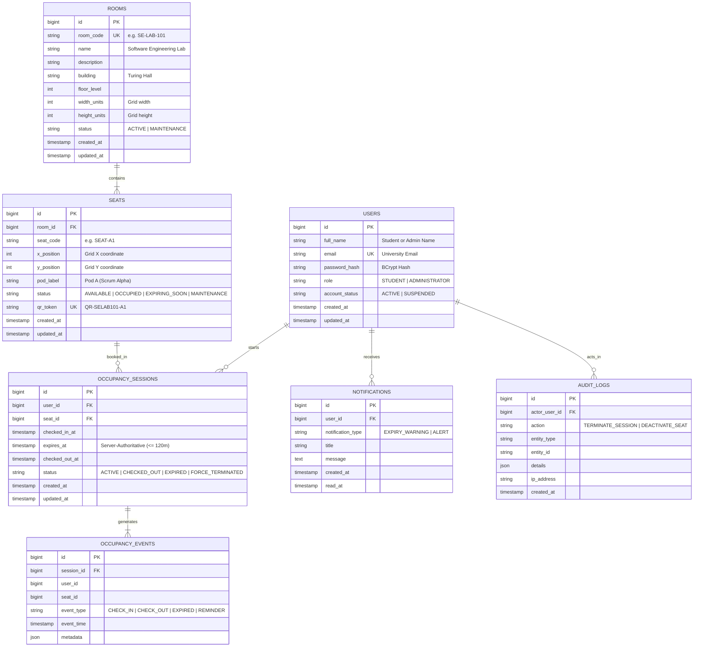

# Database Entity-Relationship Diagram (ERD) & Data Dictionary

## 1. Mermaid Entity-Relationship Diagram

## 2. Table Schemas & Constraints

### `users`
- Stores user credentials, role-based access flag (`STUDENT`, `ADMINISTRATOR`), and account state.
- Passwords are encrypted strictly using Spring Security's `BCryptPasswordEncoder`.

### `rooms`
- Represents a physical lab space. Holds dimensions (`width_units`, `height_units`) used by the frontend 2D layout canvas.

### `seats`
- Represents an individual desk or workstation within a room.
- Holds `x_position` and `y_position` integer coordinates.
- Unique constraint: `(room_id, seat_code)` prevents naming collisions.
- Unique `qr_token` safely mapped to physical printed QR sticker without leaking user data.

### `occupancy_sessions`
- Authoritative record of who checked in to which seat and when.
- `expires_at` is always computed and enforced on the server (max 120 minutes from `checked_in_at`).
- Concurrency rule: At most one session per student with status `ACTIVE`, and at most one active session per seat.

### `occupancy_events`
- Append-only event log capturing every transition for audit compliance and Recharts analytics.

### `notifications`
- In-app notification queue, especially for the 10-minute warning prior to session expiration.

### `audit_logs`
- Administrative accountability log recording admin terminations, room modifications, and role updates.
