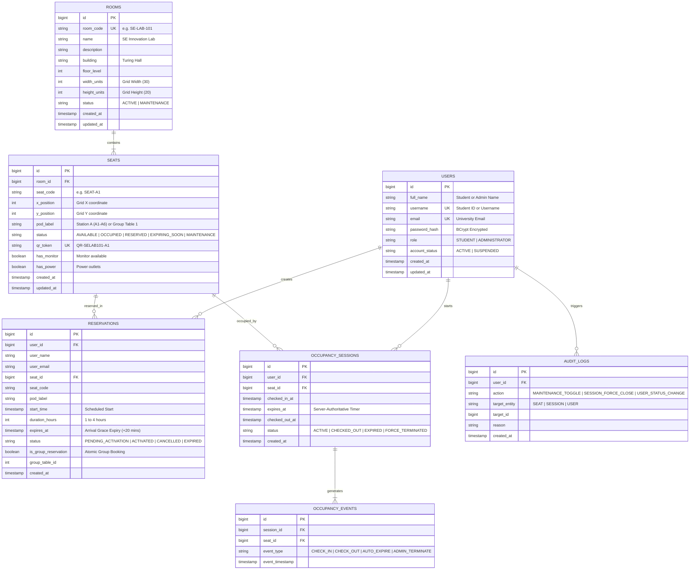

# Database Entity-Relationship Diagram (ERD) & Data Dictionary

## 1. Mermaid Entity-Relationship Diagram

---

## 2. Table Data Dictionary

### `users`
| Column | Type | Constraints | Description |
|:---|:---|:---|:---|
| `id` | `BIGINT` | PK, AUTO_INCREMENT | Unique user identifier |
| `username` | `VARCHAR(50)` | UNIQUE, NOT NULL | Student ID or login username |
| `full_name` | `VARCHAR(100)` | NOT NULL | Display name |
| `email` | `VARCHAR(150)` | UNIQUE, NOT NULL | Lamduan university email address |
| `password_hash`| `VARCHAR(255)` | NOT NULL | BCrypt password hash |
| `role` | `VARCHAR(20)` | NOT NULL | `STUDENT` or `ADMINISTRATOR` |
| `account_status`| `VARCHAR(20)`| NOT NULL | `ACTIVE` or `SUSPENDED` |
| `created_at` | `TIMESTAMP` | NOT NULL | Account creation timestamp |

### `rooms`
| Column | Type | Constraints | Description |
|:---|:---|:---|:---|
| `id` | `BIGINT` | PK, AUTO_INCREMENT | Room identifier |
| `room_code` | `VARCHAR(30)` | UNIQUE, NOT NULL | Short code (`SE-LAB-101`) |
| `name` | `VARCHAR(100)`| NOT NULL | Human-readable name |
| `width_units` | `INT` | NOT NULL | 2D canvas grid width |
| `height_units`| `INT` | NOT NULL | 2D canvas grid height |
| `status` | `VARCHAR(20)` | NOT NULL | `ACTIVE` or `MAINTENANCE` |

### `seats`
| Column | Type | Constraints | Description |
|:---|:---|:---|:---|
| `id` | `BIGINT` | PK, AUTO_INCREMENT | Workstation identifier |
| `room_id` | `BIGINT` | FK, NOT NULL | References `rooms(id)` |
| `seat_code` | `VARCHAR(30)` | NOT NULL | e.g. `SEAT-A1` |
| `pod_label` | `VARCHAR(50)` | NOT NULL | Station name (`Station A`, `Group Table 1`) |
| `x_position` | `INT` | NOT NULL | Grid coordinate X |
| `y_position` | `INT` | NOT NULL | Grid coordinate Y |
| `status` | `VARCHAR(30)` | NOT NULL | `AVAILABLE`, `OCCUPIED`, `RESERVED`, `EXPIRING_SOON`, `MAINTENANCE` |
| `qr_token` | `VARCHAR(100)`| UNIQUE, NOT NULL | Unique physical QR code payload |
| `has_monitor` | `BOOLEAN` | DEFAULT TRUE | Monitor equipped |
| `has_power` | `BOOLEAN` | DEFAULT TRUE | Power strip available |

### `reservations`
| Column | Type | Constraints | Description |
|:---|:---|:---|:---|
| `id` | `BIGINT` | PK, AUTO_INCREMENT | Reservation identifier |
| `user_id` | `BIGINT` | FK, NOT NULL | Reserving student |
| `seat_id` | `BIGINT` | FK, NOT NULL | Target workstation |
| `start_time` | `TIMESTAMP` | NOT NULL | Scheduled start time |
| `duration_hours`| `INT` | NOT NULL | 1 to 4 hours |
| `expires_at` | `TIMESTAMP` | NOT NULL | Grace period cut-off (+20m) |
| `status` | `VARCHAR(30)` | NOT NULL | `PENDING_ACTIVATION`, `ACTIVATED`, `CANCELLED`, `EXPIRED` |
| `is_group_reservation`| `BOOLEAN` | DEFAULT FALSE | Atomic group table booking |

### `occupancy_sessions`
| Column | Type | Constraints | Description |
|:---|:---|:---|:---|
| `id` | `BIGINT` | PK, AUTO_INCREMENT | Active work session identifier |
| `user_id` | `BIGINT` | FK, NOT NULL | Active student |
| `seat_id` | `BIGINT` | FK, NOT NULL | Occupied workstation |
| `checked_in_at`| `TIMESTAMP` | NOT NULL | Physical QR scan timestamp |
| `expires_at` | `TIMESTAMP` | NOT NULL | Authoritative session end time |
| `checked_out_at`| `TIMESTAMP`| NULLABLE | Session release timestamp |
| `status` | `VARCHAR(30)` | NOT NULL | `ACTIVE`, `CHECKED_OUT`, `EXPIRED`, `FORCE_TERMINATED` |
